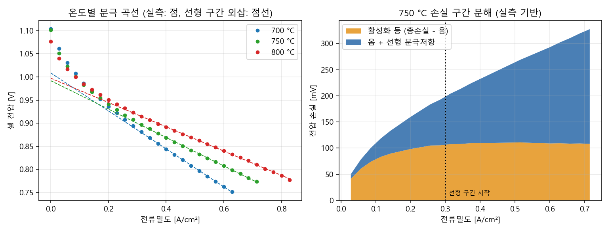
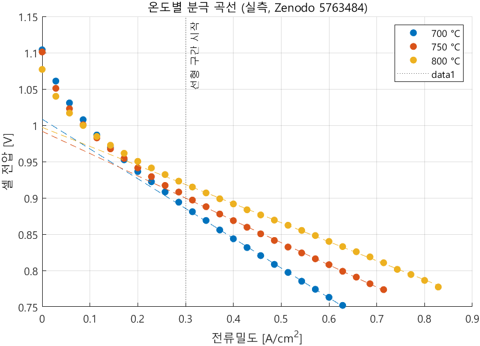
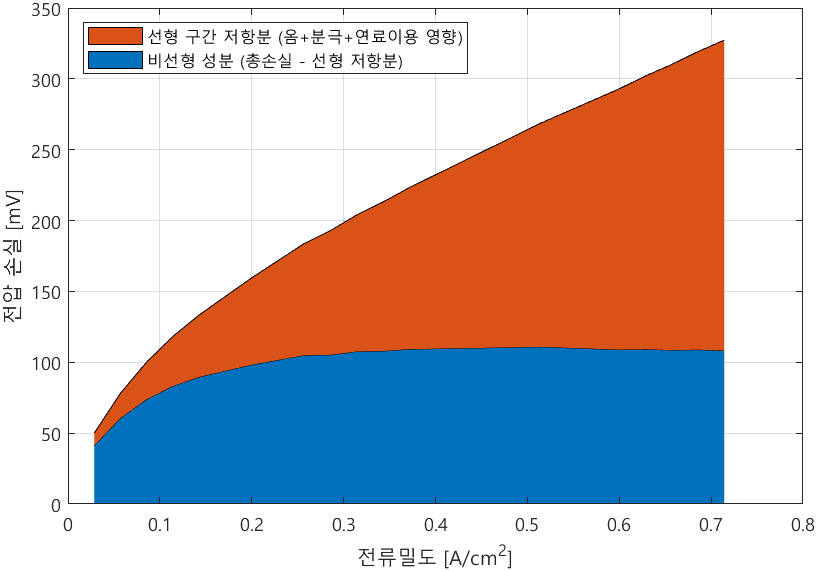
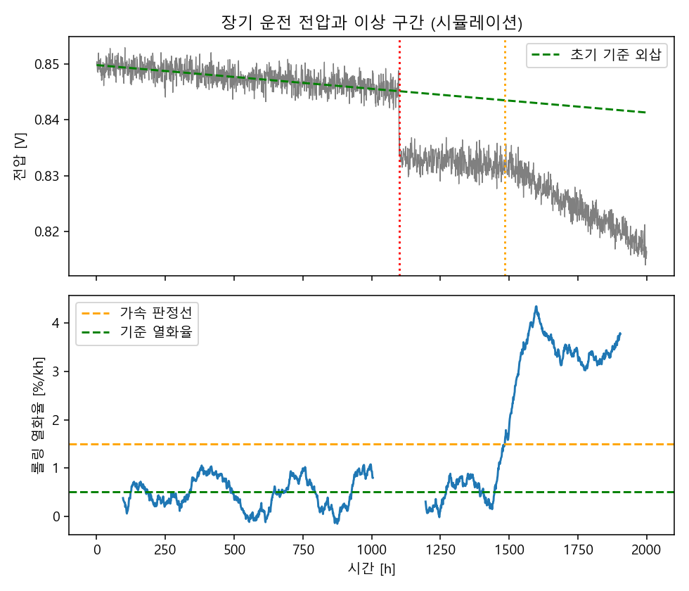
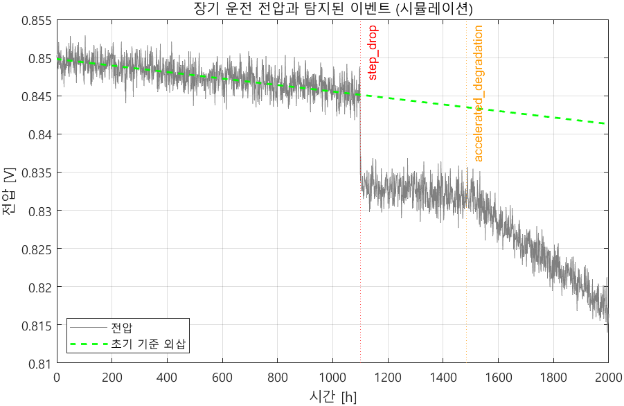
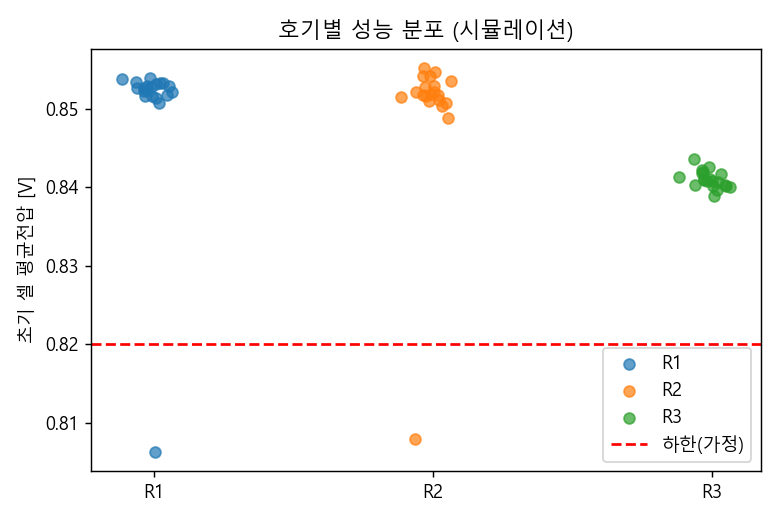
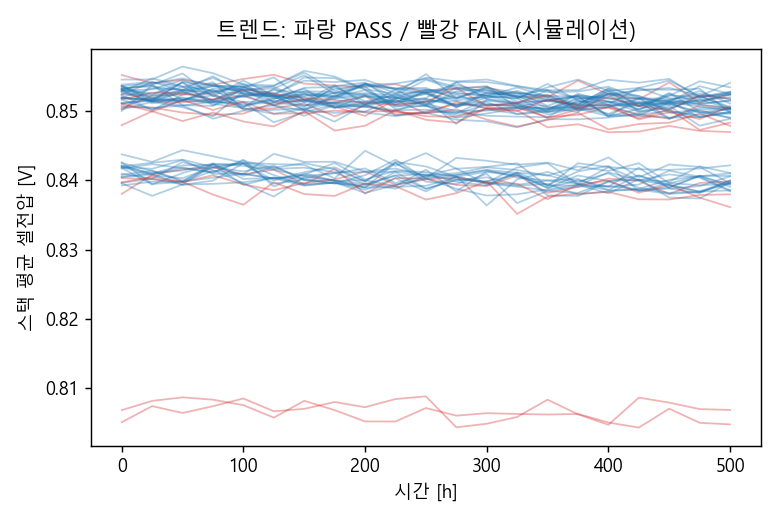
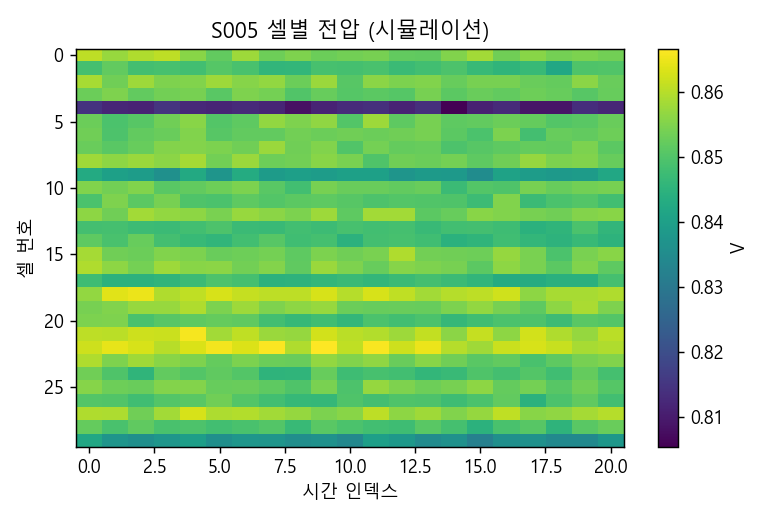
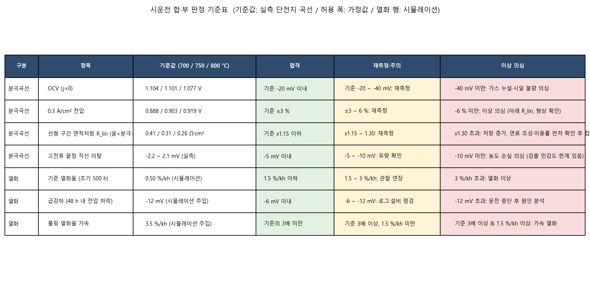

# SOFC 스택 시운전 데이터 분석

SOFC 스택 시운전 평가 데이터로 합·부 판정, 열화 트렌드, 호기별 편차, 분극곡선 손실 구간 분해를 다루는 분석 프로젝트입니다.
시뮬레이션 데이터와 공개 실측 데이터를 함께 사용했고, 코드는 Claude와 함께 작성했습니다.

## 핵심 결과
**이 프로젝트에서 가장 중요하게 본 것은 결함을 몇 % 맞혔는지가 아니라, 어떤 조건에서 판정이 흔들리는지입니다.**
- 시뮬레이션에서 측정 노이즈를 1.5 mV에서 3 mV로 키우면, 이벤트를 넣지 않은 정상 런 30개 중 25개에서 오경보가 났습니다. 5 mV에서는 주입한 12 mV 급강하를 30번 중 한 번도 잡지 못했습니다(`out/noise_sweep.csv`). 오경보를 줄이려고 임계값만 올리면 놓치면 안 되는 이상까지 놓칩니다.
- 실측 단전지 곡선에서 저항(R_lin)은 옴 저항이 아니라 옴, 분극, 연료이용이 합쳐진 값입니다. 같은 750 °C에서 수소 농도를 90 %에서 25 %로 낮추면 2.6배가 되어, 저항이 늘면 연료 조건부터 확인하도록 기준을 고쳤습니다.

**실제 시험에 적용하기 전에 할 검증 (계획이며 아직 하지 않았습니다)**
1. 정상 반복 시험으로 호기별 측정 변동을 먼저 파악하고, 그 값으로 노이즈 수준과 임계값을 정합니다.
2. 기준을 정하는 데 쓰지 않은 로그에서 오경보율과 미검출률을 각각 확인합니다.
3. 그 전까지 이 탐지 결과는 자동 불합격이나 시험 중단의 근거가 아니라, 원시 로그와 운전 조건을 다시 확인하라는 신호로만 씁니다.

> **데이터 구분:** 스택 60개 평가 데이터와 2000 h 열화 데이터는 시뮬레이션이고, 분극 곡선 분석은 공개 실측 데이터(Zenodo 5763484)입니다.
> 모델 파라미터와 합·부 기준(SPEC)은 직접 정한 가정값이며 특정 기업의 실제 제품·시험 데이터·양산 기준이 아닙니다.

## 구성
| 파일 | 내용 |
|---|---|
| `src/sofc_model.py` | Nernst + 활성화 + 옴 + 농도 손실의 0차원 셀 전압 모델 |
| `src/simulate.py` | 스택 60개 × 30셀 × 500h 평가 데이터 생성, 결함 3종 주입(가스 누설, 접촉 열화, 전체 저성능), 호기 R3 온도 편차 |
| `src/analyze.py` | 스택 특징 추출, 합·부 판정 5개 기준, 규칙 기반 원인 분류 |
| `src/run_all.py` | 전체 실행, 그림·표 생성, 주입 결함 대비 검증 |
| `src/seed_sweep.py` | 시드 20개로 분류 정확도 분포 확인 |
| `matlab/plot_results.m` | MATLAB(R2024b)로 분극 곡선, 호기 박스플롯, 트렌드, 셀 히트맵, 판정 경계 그래프 5장 생성 (`out/m_*.png`) |
| `matlab/plot_real.m` | MATLAB로 실측 분극 곡선, 손실 구간 분해, 열화 탐지 결과, 판정 기준표 그림 생성 |

## 실행
```powershell
pip install -r requirements.txt
python -I run_all.py
```
`run_all.py`가 아래 스크립트 10개를 순서대로 실행하고 `tests/`의 테스트 12개까지 돌립니다. 개별 실행은 `python -I src/<이름>.py`입니다.
버전은 `requirements.txt`에 고정했고, 결과는 `out/`에 저장됩니다. MATLAB 그림은 `matlab/*.m`을 별도로 실행합니다. 한글 글꼴은 Windows의 Malgun Gothic을 가정하므로 다른 OS에서는 글꼴 경고가 나올 수 있습니다.

## 결과 그림
공개 실측 분극 곡선 (Python / MATLAB)





장기 운전 열화 탐지 (시뮬레이션)




양산 평가 시뮬레이션 (스택 60개)





## 합·부 판정 기준표
기준값은 Zenodo 5763484 실측 단전지 곡선(H2 50 %/N2 50 %, 3.5 cm² 셀)에서 계산했고, 허용 폭은 가정값입니다.

| 구분 | 항목 | 기준값 (700 / 750 / 800 °C) | 합격 | 재측정·주의 | 이상 의심 |
|---|---|---|---|---|---|
| 분극곡선 | OCV (j=0) | 1.104 / 1.101 / 1.077 V | 기준 -20 mV 이내 | 기준 -20 ~ -40 mV: 재측정 | -40 mV 미만: 가스 누설·시일 불량 의심 |
| 분극곡선 | 0.3 A/cm² 전압 | 0.888 / 0.903 / 0.919 V | 기준 ±3 % | ±3 ~ 6 %: 재측정 | -6 % 미만: 이상 의심 (아래 R_lin, 형상 확인) |
| 분극곡선 | 선형 구간 면적저항 R_lin (옴+분극+연료이용 합산) | 0.41 / 0.31 / 0.26 Ω·cm² | 기준 x1.15 이하 | x1.15 ~ 1.30: 재측정 | x1.30 초과: 저항 증가. 연료 조성·이용률 먼저 확인 후 접촉·전극 열화 의심 |
| 분극곡선 | 고전류 끝점 직선 이탈 | 0 ~ -1 mV (실측) | -5 mV 이내 | -5 ~ -10 mV: 유량 확인 | -10 mV 미만: 농도 손실 의심 (검출 민감도 한계 있음) |
| 열화 | 기준 열화율 (초기 500 h) | 0.50 %/kh (시뮬레이션) | 1.5 %/kh 이하 | 1.5 ~ 3 %/kh: 관찰 연장 | 3 %/kh 초과: 열화 이상 |
| 열화 | 급강하 (48 h 내 전압 하락) | -12 mV (시뮬레이션 주입) | -6 mV 이내 | -6 ~ -12 mV: 로그·설비 점검 | -12 mV 초과: 운전 중단 후 원인 분석 |
| 열화 | 롤링 열화율 가속 | 3.5 %/kh (시뮬레이션 주입) | 기준의 3배 미만 | 기준 3배 이상, 1.5 %/kh 미만 | 기준 3배 이상 & 1.5 %/kh 이상: 가속 열화 |

열화 행의 기준값은 실측이 아니라 시뮬레이션입니다. 실제 양산 스택에는 자체 기준 곡선으로 다시 계산해야 합니다.



## 한 줄 요약
가상의 SOFC 스택 60개 평가 로그로 합·부 판정, 열화 트렌드, 호기별 편차, 결함 원인 분류까지 한 번에 돌리는 분석 파이프라인을 만들고, 주입한 결함 12건과 대조해 검증했습니다.

## 결과 (시드 42, 시뮬레이션)
| 항목 | 값 |
|---|---|
| 합·부 판정 | PASS 48, FAIL 12 |
| 원인 분류 | 시드 20개 정확도 평균 0.970, 최소 0.867. 호기별로는 R1 0.99, R2 0.997, R3 0.922로, 호기 편차가 겹치는 R3에서 낮습니다. 주입 패턴을 되찾는 비율이며 실제 원인 진단 정확도가 아닙니다 |
| 누설 셀 번호 | 7건 중 7건 일치 |
| 호기 R3 평균 전압 | 결함 없는 스택 기준 R1·R2보다 약 11.4 mV 낮음 (95% 구간 -12.2 ~ -10.5 mV, 순열검정 p<0.001) |

분류 규칙을 시뮬레이터 구조를 알고 만들었고 호기 R3의 -12 K 편차도 시뮬레이터가 넣은 값이라, 위 수치는 "넣은 것을 되찾는지" 확인하는 용도입니다. 실제 설비 분석 결과가 아닙니다.

## 공개 실측 데이터 분석
출처: Del Zotto 외, Zenodo 5763484 (https://zenodo.org/records/5763484, CC BY 4.0). 단전지 분극 곡선을 700, 750, 800 °C에서 측정한 자료이며,
원본 xlsx는 `data/zenodo_5763484/`에 두었습니다. 같은 연구진의 논문은 Energies 14(2038)입니다.

| 단계 | 파일 | 내용 |
|---|---|---|
| 1. 분극곡선 구간 분리 | `src/analyze_real.py` | 온도별 곡선 비교, 선형 구간 직선 피팅, 총 손실에서 선형 저항분을 뺀 비선형 성분 분리, 고전류 끝점 이탈 확인 |
| 2. 민감도 검증 | `src/sensitivity.py` | H2 농도 변화와 선형 구간 시작점 변화에 따른 R_lin 변동 (`out/h2_dependence.*`, `out/jlin_sensitivity.csv`) |
| 3. 열화 분석 | `src/degradation.py` | 초기 500 h 기준 열화율, 급강하와 열화 가속 구간 탐지 |
| 4. 호기 효과 통계 | `src/rig_stats.py` | 시뮬레이션 스택의 호기 간 평균 차이, 신뢰구간, 순열검정 |
| 5. 노이즈 민감도 | `src/noise_sweep.py` | 노이즈 1.5/3/5/8 mV에서 급강하·가속 검출률과 오경보율 (시드 30개씩, `out/noise_sweep.csv`) |
| 6. 측정 불확도 판정 | `src/guard_band.py` | 불확도 U(k=2)를 반영해 PASS, 재측정, FAIL 구간 판정 (`out/guard_band_result.csv`) |
| 7. 시험 성적서·이력 | `src/report.py` | 스택별 성적서(`out/reports/`)와 판정 이력표(`out/test_history.csv`) 자동 생성 |
| 8. 판정 기준표 | `src/decision_table.py` | 합격, 재측정, 이상 의심 3단계 1장 표 (`out/decision_table.png`, `.md`, `.csv`) |

결과 요약
- 선형 구간 직선 피팅 오차는 0.8~0.9 mV이고, 선형 구간 면적저항 R_lin은 700 / 750 / 800 °C에서 0.41 / 0.31 / 0.26 Ω·cm²입니다. 점 수가 12~19개라 맞춤이 좋다는 것이 검증을 뜻하지는 않습니다.
- R_lin은 옴 저항이 아닙니다. 옴 저항, 선형 구간의 분극저항, 연료 이용에 따른 전압 하강이 합쳐진 값입니다. 같은 750 °C에서 H2 농도만 바꿔도 R_lin이 90 % 0.26, 50 % 0.31, 25 % 0.68, 10 % 2.18 Ω·cm²로 달라집니다(`out/h2_dependence.png`). 10 % 곡선은 측정점이 8개뿐이고 직선 맞춤 오차가 약 14 mV로 커서 참고치로만 보고, 비교는 맞춤이 안정적인 90 %와 25 %(2.6배)를 기준으로 합니다. 접촉 저항이 같아도 연료 조건에 따라 크게 변하므로, 기준표에서는 저항 증가 시 연료 조건을 먼저 확인하도록 고쳤습니다. 옴 저항을 따로 구하려면 EIS가 필요합니다.
- 선형 구간 시작점 J_LIN을 0.15~0.5 A/cm²로 바꾸면 700 °C의 R_lin이 0.433~0.395로 약 9 % 움직입니다(`out/jlin_sensitivity.csv`). 기준표의 허용 폭 15 %와 같은 크기이므로 구간 선택이 판정에 영향을 줄 수 있습니다.
- 고전류 곡률(농도 손실) 검출은 끝점 3개를 뺀 중간 구간으로 직선을 피팅하고 끝점의 이탈을 보는 방식으로 고쳤습니다. 끝점을 피팅에 넣으면 직선이 함께 휘어 이탈이 작아지기 때문입니다. 실측 곡선의 이탈은 700 °C 2.1 mV, 750 °C 1.9 mV, 800 °C -2.2 mV로 기준(-5 mV)에 걸리지 않았습니다.
  다만 이 방법의 감도는 낮습니다. 합성 곡선으로 확인하니 끝점(j=0.8)의 농도 손실이 약 90 mV(한계전류 0.9 A/cm²)면 검출되지만, 46~67 mV(한계전류 1.0~1.2)여도 -0.1~-4.3 mV로 놓칩니다(`tests/test_curvature.py`가 이 한계를 테스트로 고정). 그래서 "농도 손실이 없다"가 아니라 "이 방법으로는 큰 농도 손실만 볼 수 있고, 실측 곡선에서는 보이지 않았다"가 정확합니다.
  참고 지표로 끝 구간 기울기 / 앞 구간 기울기 비를 계산했더니 700, 750, 800 °C가 0.93, 0.95, 1.10이었습니다. 합성 곡선에서 농도 손실이 없을 때 약 0.9, 한계전류 1.0일 때 약 1.1이므로, 800 °C 곡선은 약한 농도 손실의 가능성을 배제하지 못합니다.
- 열화 분석: 공개 자료에 장시간 전압 원자료가 없어 시뮬레이션 2000 h 데이터로 방법만 확인했습니다. 주입한 기준 열화율 0.5 %/kh를 0.50 %/kh로, 1100 h의 12 mV 급강하를 11.7 mV로 되찾았습니다. 가속 열화 탐지는 앞뒤 구간을 모두 쓰는 사후 분석이라, 이벤트(1500 h)보다 앞선 1485 h로 나옵니다. 실시간 중단 판단에는 쓸 수 없습니다.
- 노이즈 민감도: 노이즈 1.5 mV에서 급강하와 가속 검출 30/30, 오경보 0/30이지만, 3 mV에서는 오경보가 25/30으로 늘고 5 mV에서는 12 mV 급강하를 한 번도 검출하지 못합니다(0/30). 임계값은 노이즈 수준에 맞춰 다시 정해야 하며, 현재 임계값은 1.5 mV 가정입니다.
- 측정 불확도: 실측 곡선 선형 잔차 0.9 mV와 계측기 정확도 0.5 mV(가정)로 U(k=2)=2.06 mV를 구해 판정 경계에 반영했습니다. 시뮬레이션 스택 60개는 서로 충분히 떨어져 있어 재측정 구간에 걸린 스택은 0개였습니다. 경계 근처 스택이 있는 실제 데이터에서 의미가 커지는 장치입니다. 항목별로 PASS, RETEST, FAIL을 먼저 정하고 확정 FAIL, RETEST, PASS 순으로 합칩니다. 외부 검토에서 기존 종합 판정이 재측정 구간을 덮어쓰는 버그(평균 전압 0.819 V가 RETEST가 아니라 FAIL로 나옴)를 지적받아 고쳤고, 이 사례를 `tests/test_judgement.py`의 회귀 테스트로 넣었습니다.
- 시험 성적서: 스택별로 판정 항목, 측정값, 기준, 최종 판정, 관측과 가설(점검 대상), 점검 순서, 셀 전압 그림을 한 장으로 자동 생성합니다. 원인 분류는 "누설"처럼 단정하지 않고 "단일 셀 저전압(관측) / 누설 등 점검 필요(가설)"로 나눠 적습니다. 다른 원인도 같은 전압 패턴을 낼 수 있기 때문입니다. 양식은 임의로 만든 예시이며 실제 양산 성적서가 아닙니다.
- 판정 기준표의 기준값은 이 단전지 곡선 한 개에서, 허용 폭은 가정값에서 나왔습니다. 계측 불확도와 반복 측정 산포는 반영하지 않았고 양산 스택 기준이 아닙니다.

## 한계
- 분류 규칙을 시뮬레이터를 알고 만들었기 때문에 정확도는 낙관적입니다. 실측 데이터 성능을 뜻하지 않습니다.
- 합·부 기준(SPEC)은 가정값이며 실제 양산 기준이 아닙니다.
- 모델은 0차원이라 열·유동 분포, 스택 압축, 시일 거동을 다루지 않습니다.
- 다음 단계: 실측 전압·전류·온도 로그에 같은 파이프라인을 적용하고, 임계값을 데이터로 보정합니다.
- 호기 효과와 분류 규칙은 시뮬레이터가 주입한 값을 되찾는 확인이며, 실제 설비의 호기 분석이 아닙니다.
- 단전지 한 개의 곡선 기준값을 스택 판정에 그대로 쓸 수 없습니다. 셀 수, 압축, 매니폴드 분배가 다릅니다.
- 열화 탐지는 사후 분석이며, 초기 컨디셔닝 구간과 노이즈 수준(시뮬레이션 1.5 mV)에 민감합니다. 노이즈가 3~5 mV 수준이면 임계값 재조정이 필요하다는 점을 `noise_sweep.py`로 직접 확인했습니다.
- 복합 결함(예: 누설과 접촉 열화가 한 스택에 함께 있는 경우)은 시뮬레이션하지 않았습니다. 분류 규칙은 결함이 하나씩 있다고 가정합니다.
- 누설을 한 셀의 저항 증가로 모사했고 분류기는 셀간 편차를 보고 누설로 분류하므로, 정확도는 주입 패턴 복원율에 가깝습니다.
