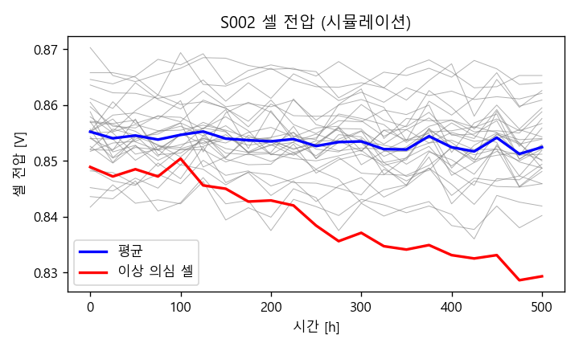

# 시험 성적서 S002 (시뮬레이션 데이터)

호기 R2 | 시험 전류밀도 0.4 A/cm² | 500 h | 셀 30개

| 항목 | 측정값 | 기준 | 결과 |
|---|---|---|---|
| 초기 평균 셀전압 | 0.855 V | 0.82 V 이상 | PASS |
| 초기 최저 셀전압 | 0.843 V (셀 23) | 0.78 V 이상 | PASS |
| 셀간 편차 | 23 mV | 40 mV 이하 | PASS |
| 스택 열화율 | 0.62 %/kh | 1.5 %/kh 이하 | PASS |
| 최악 셀 열화율 | 5.09 %/kh (셀 24) | 3.0 %/kh 이하 | FAIL |

**최종 판정: FAIL**  원인 분류: contact_degradation

점검 순서: 1) 해당 셀 열화율 추이 확인 2) 접촉 압력·체결 상태 점검 3) 연료 조건 확인 후 열화 판정

기준값은 가정값이며 측정 불확도 약 2 mV(k=2)를 반영한 판정입니다. 실제 양산 성적서가 아닙니다.
