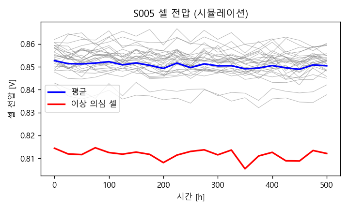

# 시험 성적서 S005 (시뮬레이션 데이터)

호기 R2 | 시험 전류밀도 0.4 A/cm² | 500 h | 셀 30개

| 항목 | 측정값 | 기준 | 결과 |
|---|---|---|---|
| 초기 평균 셀전압 | 0.852 V | 0.82 V 이상 | PASS |
| 초기 최저 셀전압 | 0.813 V (셀 5) | 0.78 V 이상 | PASS |
| 셀간 편차 | 50 mV | 40 mV 이하 | FAIL |
| 스택 열화율 | 0.53 %/kh | 1.5 %/kh 이하 | PASS |
| 최악 셀 열화율 | 1.10 %/kh (셀 15) | 3.0 %/kh 이하 | PASS |

**최종 판정: FAIL**

관측: 단일 셀 저전압, 셀간 편차가 기준 초과

가설(점검 대상): 가스 누설·시일 불량 등 점검 필요 (접촉 불량이나 셀 불량도 같은 패턴을 낼 수 있음)

점검 순서: 1) 해당 셀 전압과 이웃 셀 비교 2) 가스 공급·시일 상태 점검 3) 누설 시험 후 재조립 여부 판단

기준값은 가정값이며 측정 불확도 약 2 mV(k=2)를 항목별로 반영한 판정입니다. 가설은 진단이 아니라 점검 대상입니다. 실제 양산 성적서가 아닙니다.
