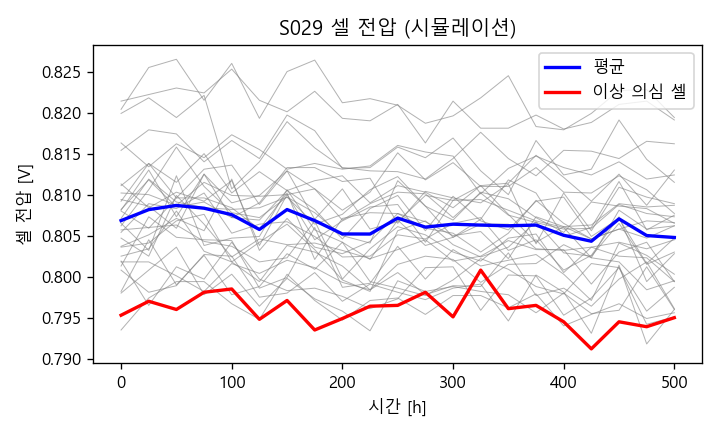

# 시험 성적서 S029 (시뮬레이션 데이터)

호기 R2 | 시험 전류밀도 0.4 A/cm² | 500 h | 셀 30개

| 항목 | 측정값 | 기준 | 결과 |
|---|---|---|---|
| 초기 평균 셀전압 | 0.808 V | 0.82 V 이상 | FAIL |
| 초기 최저 셀전압 | 0.796 V (셀 1) | 0.78 V 이상 | PASS |
| 셀간 편차 | 28 mV | 40 mV 이하 | PASS |
| 스택 열화율 | 0.70 %/kh | 1.5 %/kh 이하 | PASS |
| 최악 셀 열화율 | 1.33 %/kh (셀 4) | 3.0 %/kh 이하 | PASS |

**최종 판정: FAIL**  원인 분류: low_performance

점검 순서: 1) 호기 온도·계측 정합성 확인 2) 연료 조성·이용률 확인 3) 동일 조건 재측정

기준값은 가정값이며 측정 불확도 약 2 mV(k=2)를 반영한 판정입니다. 실제 양산 성적서가 아닙니다.
